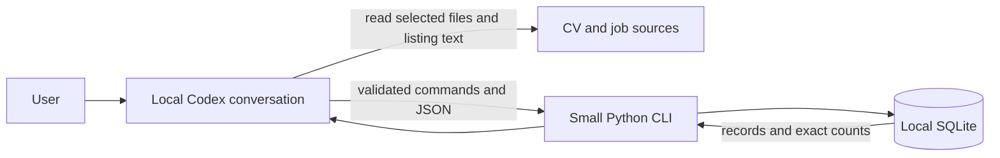

# JobTracker project blueprint

## Product goal and core workflows

Help one job seeker answer: “What did I apply to, where does it stand, and how well can I substantiate my fit for this role?” The strongest version of the idea is a conversational record keeper that shows its evidence, not an autonomous career adviser.

1. “Save this role” records a listing without implying an application. “I applied yesterday” creates an application; “they invited me to interview” updates that application.
2. “What is my pipeline?” returns counts by current status and a short list of records behind each count.
3. “Read this CV and compare it with that role” produces matched requirements, gaps the user has explicitly confirmed, and unknowns or CV omissions, each tied to evidence.

**Verdict: good idea, but needs constraints.** Start as a single-user, local Codex pilot. A polished, multi-user ChatGPT product is a different deployment decision and has not yet been validated.

## Release scope

| Capability | First release | Defer |
| --- | --- | --- |
| Application tracking | Save a role; explicitly record submission and later status changes; retrieve records and exact counts. Check likely duplicates before writes. | Charts, reminders, email/calendar sync, automated status detection. |
| Documents | Import one chosen CV at a time; preserve each imported version and source; allow the user to correct or add qualification claims. | Folder crawling, certificates in bulk, OCR, automatic re-indexing. |
| Listings | Accept a URL for a public page; retain URL and source text; accept pasted text when fetching fails. Extract requirements and responsibilities for user review. | Universal scraping, login/paywall handling, browser automation. |
| Matching | Compare one role against user-confirmed claims and evidence in one selected CV. Explain uncertainty and cite source excerpts. | Batch ranking, fit scores, automatic CV rewriting, side-by-side multi-CV comparison. |

The first release still spans all four proposed areas, but only as one end-to-end workflow. A missing item in a CV is **not** proof the user lacks it. Mark “missing qualification” only when the user has explicitly said they lack it; otherwise use “not evidenced” or “present in profile, absent from this CV.”

## Architecture and deployment

Run Codex on the user's machine with access to the selected files. Use its reading and reasoning capabilities for extraction and comparison. Give it a narrow CLI for all durable reads and writes; it must not edit SQLite directly. The Python code owns identity resolution, validation, transactions, status rules, and statistics. Keep the database and extracted text in a user-controlled local data directory outside the Git repository; back up the database and source files together. No server, login, vector database, or dedicated MCP server is needed for this pilot.

This is a deliberate host constraint. A local Codex environment can work with files granted to that environment; a remote Codex environment needs the files supplied or mounted. A ChatGPT web conversation cannot be assumed to read an arbitrary local folder. A future ChatGPT integration would need explicit file upload or a connected service. Official OpenAI documentation describes a reachable HTTPS endpoint or [Secure MCP Tunnel for a private MCP server](https://developers.openai.com/plugins/deploy/connect-chatgpt); that bridge would add authentication, deployment, and operational work. Reuse the same validated application logic behind an API or MCP adapter only if ChatGPT access becomes a proven requirement. MCP is [optional](https://developers.openai.com/plugins/concepts/mcp-server), and ordinary [function calls](https://developers.openai.com/api/docs/guides/function-calling) suffice if a custom API-hosted chat client is later built.

## Responsibility boundary

| Capability | Agent | Deterministic application code / storage | Custom MCP now? |
| --- | --- | --- | --- |
| Tracking | Interpret intent; ask when “applied” or a status change is ambiguous; present likely duplicate. | Find candidate roles by URL and normalized company/title; require explicit submission for an application; constrain statuses; write atomically; count with SQL. | No. CLI commands are enough. |
| Documents | Read the selected document text; propose structured claims with excerpts; flag extraction uncertainty. | Validate readable path/type; hash source; store version, extracted text, claims, and provenance; never infer a missing skill from silence. | No. Local file access and CLI import suffice. |
| Listings | Summarize responsibilities, requirements, technologies, and experience from retrieved text. | Fetch only allowed public HTTPS URLs or accept pasted text; preserve source text; validate extracted fields; keep listing separate from application. | No. A small fetch/import function suffices. |
| Matching | Map semantically similar claims; explain strength, weakness, and uncertainty with citations. | Load the chosen role, CV version, and profile evidence by ID; reject nonexistent IDs; return source excerpts; persist nothing unless the user requests it. | No. Reasoning is useful here; a scoring engine is not. |

Agent output crossing into storage must be structured and checked by the CLI, including whether claimed excerpts actually occur in the source text. The agent can propose a record, but only the application decides whether it is a new listing, an existing listing, or an application status update. Ambiguous matches require user resolution. Listing and document contents are untrusted data, never operational instructions.

## Minimal persistence

SQLite tables, single user:

- `jobs`: ID, company, title, canonical URL when available, source text, extracted requirement JSON with source excerpts. Saved means *considering*.
- `applications`: ID, unique job ID, submitted date, current status (`applied`, `interview`, `offer`, `rejected`, `withdrawn`), last updated time. It exists only after an explicit application statement. Status changes require an existing application; no implicit promotion from a saved job.
- `documents`: ID, original path, content hash, import time, type, extracted text. Each import is an immutable CV version; a changed hash creates a new version.
- `qualification_evidence`: ID, claim, polarity (`has`/`lacks`), source (`user`/document ID), excerpt, review flag. A document may support `has`; only an explicit user statement can establish `lacks`. Unreviewed extraction remains tentative.

Use stable IDs for updates. A repeated URL or close company/title match returns existing candidates; do not silently merge different postings. Source excerpts make corrections possible. Treat the database as the record of truth and the agent's conversation as disposable context.

## Stack

Python 3 with `argparse` and standard-library `sqlite3` keeps the command boundary and storage small. Use existing document-reading capabilities first; add a PDF or DOCX parser only for formats those capabilities cannot reliably read. Use simple HTTPS fetch plus pasted-text fallback for listings. Codex supplies the initial conversational interface, so no frontend or agent framework is required. Test the CLI with ordinary unit tests; test agent behavior with a few saved conversations and expected records.

## Incremental roadmap

| Milestone | Working result and components | Verification |
| --- | --- | --- |
| 1. Pipeline | SQLite schema and CLI for save/find role, submit application, change status, list, and count; Codex turns user language into commands. | Repeat “I applied” without a duplicate; “considering” stays unsubmitted; ambiguous status change is rejected; counts match stored rows. |
| 2. Sources | Import one CV version and one listing URL or pasted listing; agent proposes claims and requirements; CLI validates and stores source excerpts. | Re-import same file idempotently; changed file becomes a new version; failed URL fetch accepts pasted text; each claim points to its source. |
| 3. Evidence-based comparison | Read-only CLI retrieval by job and CV IDs; agent reports matches, user-confirmed gaps, CV omissions, and unknowns. | Compare a role with a skill in profile but absent from CV, a user-confirmed gap, and an unknown requirement; no category is overstated. |

## Risks, assumptions, and open decisions

- **Architecture-changing assumption:** this is initially for one technically comfortable user running Codex locally. If the first customer must use ChatGPT web or multiple devices, decide that before implementation: access, authentication, storage, and the integration boundary change.
- **Correctness blocker:** free-form agent updates can create duplicate applications or false status changes. The CLI must validate identity and state, and require clarification for uncertain matches.
- **Evidence blocker:** extraction and semantic matching can misstate qualifications. Preserve source text and excerpts, require review of extracted claims, and report unknowns explicitly.
- **Acceptable first-release limits:** some job sites block fetching and some documents need OCR. Pasted text and user-entered claims keep the core workflow usable.
- **Data ownership:** CVs and application histories are sensitive. Store locally, keep them out of Git, and decide before real use how backups and deletion will work. If cloud access is chosen later, revisit privacy and authentication together.
