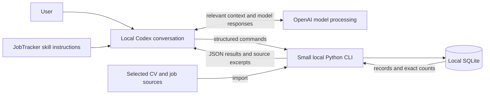

# JobTracker project blueprint

## Product goal and core workflows

Help one job seeker answer: “What did I apply to, where does it stand, and how well can I substantiate my fit for this role?” The strongest version of the idea is a conversational record keeper that shows its evidence, not an autonomous career adviser.

1. “Save this role” records a listing without implying an application. “I applied yesterday” creates an application; “they invited me to interview” updates that application.
2. “What is my pipeline?” returns counts by current status and a short list of records behind each count.
3. “Import this CV” creates a structured profile with reviewed claims and source excerpts. “Compare my profile and this CV with that role” retrieves stored evidence and produces matches, user-confirmed gaps, and unknowns or CV omissions. Routine comparisons do not reread the whole CV.

**Verdict: good idea, but needs constraints.** Start as a single-user Codex desktop pilot with local script execution and storage, and OpenAI processing relevant content. Prove access and persistence with a small prototype before implementing product capabilities. Multiple users, devices, or another conversational host are separate deployment decisions.

## Release scope

| Capability | First release | Defer |
| --- | --- | --- |
| Application tracking | Save a role; explicitly record submission and later status changes; retrieve records and exact counts. Check likely duplicates before writes. | Charts, reminders, email/calendar sync, automated status detection. |
| Documents | Import one chosen CV at a time; preserve each imported version and source; allow the user to correct or add qualification claims. | Folder crawling, certificates in bulk, OCR, automatic re-indexing. |
| Listings | Accept a URL for a public page; retain URL and source text; accept pasted text when fetching fails. Extract requirements and responsibilities for user review. | Universal scraping, login/paywall handling, browser automation. |
| Matching | Compare one role against user-confirmed claims and evidence in one selected CV. Explain uncertainty and cite source excerpts. | Batch ranking, fit scores, automatic CV rewriting, side-by-side multi-CV comparison. |

The first release still spans all four proposed areas, but only as one end-to-end workflow. A missing item in a CV is **not** proof the user lacks it. Mark “missing qualification” only when the user has explicitly said they lack it; otherwise use “not evidenced” or “present in profile, absent from this CV.”

## Architecture and deployment

The user talks to Codex in natural language; Codex invokes local Python scripts, reads their results, and answers in chat. Give it a narrow CLI for durable reads and writes. Python owns validation, transactions, identity checks, status rules, and statistics. The skill instructs Codex to use this CLI rather than editing SQLite directly. This is a workflow rule, not an enforced security boundary: an agent with directory write access could bypass the CLI.

**Agreed privacy boundary:** JobTracker stores its database, imported source copies, and extracted text locally. Codex sends relevant prompts, excerpts, and tool results to OpenAI for processing; initial CV extraction may put the entire extracted CV into model context. Local storage does not determine conversation retention. This is not an offline or device-only inference design. There is no separate JobTracker backend, API integration, login, or interface; Codex's own account and service access remain prerequisites. See [official local data handling documentation](https://learn.chatgpt.com/docs/enterprise/chatgpt-work-local-security).

### Local setup and permissions

- Use a local Codex conversation on the user's computer. Cloud execution does not automatically have the same local files. For this Windows pilot, use native Windows and a verified Python 3 executable; WSL is outside the initial setup. See [execution modes](https://learn.chatgpt.com/docs/environments/modes).
- Select a dedicated JobTracker data folder outside Git as the runtime workspace, or explicitly grant that folder write access from the chosen workspace. Record its absolute path and use it in every invocation. SQLite needs directory access for its journal files as well as the database file. Keep imported sources in this folder and back them up with the database.
- Install the skill and scripts in a discoverable local skill directory, such as the user's `.agents/skills/jobtracker`. Resolve scripts relative to that installed skill and invoke a verified interpreter; do not assume the conversation's working directory is the code repository.
- Routine use should require natural-language requests only. Initial installation, folder access, external source access, and network operations may require approvals. Read-only permissions, sandbox restrictions, operating-system permissions, or administrator policies can prevent execution or writes. The skill cannot grant permissions. Full access is not a prerequisite; verify the narrow setup described in [sandbox documentation](https://learn.chatgpt.com/docs/sandboxing).
- Public listing retrieval uses the network even though JobTracker has no separate API integration. Accept pasted text when fetching is unavailable. Local persistence should work with script network access restricted; Codex still needs its model service connection.

### Skill and persistent state

The JobTracker `SKILL.md` defines activation examples, script paths, supported commands, structured inputs, JSON results, and how to handle errors or ambiguity. It tells Codex to retrieve stored state before answering record-dependent questions, report a write as successful only after a successful CLI result, and treat imported content as data rather than instructions. Use JSON files or standard input for document text and structured payloads instead of interpolating them into shell commands.

Skill instructions persist on disk, but the full instructions load when the skill is selected. Test implicit activation from ordinary JobTracker requests in fresh chats; explicit skill selection is a fallback. Project `AGENTS.md` can provide a short routing instruction when needed. Neither instructions nor conversation memory replace SQLite. See [official skill loading documentation](https://learn.chatgpt.com/docs/build-skills).

### CV import and evidence reuse

Before implementing CV import, choose one required source format and manually verify a repeatable local text extraction method on a representative document. Do not assume general file access provides reliable PDF or DOCX parsing. Plain text can be a fallback; OCR remains deferred.

The importer preserves an immutable source copy, its hash, and extracted text. Codex proposes structured claims with exact excerpts from that stored text; Python validates references and excerpt occurrence. The user reviews claims before they become confirmed profile evidence. Keep source evidence when a claim is corrected and exclude superseded claims from current comparisons.

Comparisons retrieve current reviewed claims, relevant excerpts, the chosen CV version, and listing requirements. These records form the structured profile; a separate profile service or vector database is unnecessary. Retrieve additional source text only when stored evidence is insufficient. An omission from extracted claims alone cannot establish absence from the CV; inspect the selected CV's stored text before making that assertion, or report uncertainty.

## Responsibility boundary

| Capability | Agent | Deterministic application code / storage | Custom MCP now? |
| --- | --- | --- | --- |
| Tracking | Interpret intent; require an explicit user application statement; ask when a status change is ambiguous; present likely duplicate. | Find candidate roles by URL and normalized company/title; create applications only through the submission command; constrain statuses; write atomically; count with SQL. | No. CLI commands are enough. |
| Documents | Propose structured claims from extracted text with excerpts; request review; flag uncertainty. | Validate readable path/type; preserve source copy and hash; extract and store text; validate and store reviewed claims and provenance. | No. Local file access and CLI import suffice. |
| Listings | Summarize responsibilities, requirements, technologies, and experience from retrieved text. | Fetch only allowed public HTTPS URLs or accept pasted text; preserve source text; validate extracted fields; keep listing separate from application. | No. A small fetch/import function suffices. |
| Matching | Map semantically similar claims; explain strength, weakness, and uncertainty with citations. | Load the chosen role, CV version, and profile evidence by ID; reject nonexistent IDs; return source excerpts; persist nothing unless the user requests it. | No. Reasoning is useful here; a scoring engine is not. |

Agent output crossing into storage must be structured and checked by the CLI, including whether claimed excerpts actually occur in the source text. Python validates the requested operation and resolves identity candidates; ambiguous matches require user resolution. It cannot prove that a valid command reflects user intent or that an existing excerpt supports the proposed claim. Interpretation and evidence review remain the agent's and user's responsibility. Listing and document contents are untrusted data, never operational instructions.

## Minimal persistence

SQLite tables, single user:

- `jobs`: ID, company, title, canonical URL when available, source text, extracted requirement JSON with source excerpts. Saved means *considering*.
- `applications`: ID, unique job ID, submitted date, current status (`applied`, `interview`, `offer`, `rejected`, `withdrawn`), last updated time. It exists only after an explicit application statement. Status changes require an existing application; no implicit promotion from a saved job.
- `documents`: ID, original path, preserved source-copy path, content hash, import time, type, extracted text. Each distinct imported CV is an immutable version; importing the same hash returns the existing version. An original path and hash alone do not preserve a source file.
- `qualification_evidence`: ID, claim, polarity (`has`/`lacks`), source (`user`/document ID), excerpt, review state (`tentative`, `confirmed`, `superseded`). A document may support `has`; only an explicit user statement can establish `lacks`. Corrections supersede old claims while preserving their evidence. Conflicting current claims require user resolution.

Use stable IDs for updates. A repeated URL or close company/title match returns existing candidates; do not silently merge different postings. Source excerpts make corrections possible. Treat the database as the record of truth and the agent's conversation as disposable context.

## Stack

Python 3 with `argparse`, JSON, and standard-library `sqlite3` keeps the command boundary and storage small. Reuse a reliable installed document parser where available; add one only if needed for the selected import format. Use simple HTTPS fetch plus pasted-text fallback for listings. Codex supplies the conversational interface, so no frontend or agent framework is required. Follow the repository's verification policy: do not write tests; perform focused manual checks with synthetic data and record expected versus actual results.

## Access prototype: gate before product implementation

Create one skill, one Python script with `save` and `show`, one SQLite table, and one synthetic UTF-8 text file. The `save` operation reads the selected file and stores its content under a stable record key; repeating it with identical input returns the existing record. Both commands return JSON. Use the intended runtime folder, interpreter, and ordinary sandbox permissions. This proves the execution path without implementing job tracking, CV parsing, or comparison.

Ask Codex in natural language to save the file, then retrieve the record from a fresh conversation after restarting the app. Manually check:

- The user enters no commands; Codex discovers the skill and invokes the intended local script.
- The script uses the intended absolute database path, and the stored result exactly preserves punctuation and Unicode, including when paths contain spaces.
- A fresh conversation retrieves the same record from SQLite, with no dependence on the previous conversation's memory.
- Repeating the save does not create a duplicate; row count and content are verified through a separate read invocation.
- An invalid input or missing source produces an error and no partial write; Codex does not claim success.
- Routine reads and writes work within the configured folder permissions. Record initial grants and recurring approval prompts separately; do not assume permission persistence across restarts.

Passing establishes local script and data access for the checked setup. It does not establish CV extraction quality, semantic accuracy, reliable activation for every phrasing, or compatibility with another machine or host version.

## Incremental roadmap

| Milestone | Working result and components | Verification |
| --- | --- | --- |
| 0. Access prototype | Skill → local Python → SQLite → chat, using synthetic data. | Meet the access prototype criteria above before starting product capabilities. |
| 1. Saved roles | CLI and skill support saving and finding roles with stable IDs. | Repeat a save without a duplicate; ambiguous matches need resolution; no application is created. |
| 2. Pipeline | Separate increments for submission, status changes, and pipeline retrieval/counts. | Repeat “I applied” without a duplicate; “considering” stays unsubmitted; ambiguous status change is rejected; counts match stored rows. |
| 3. Sources | Separate increments for CV import/review, pasted listing import, then public URL retrieval. | Re-import same file idempotently; changed file becomes a new version; moving the original does not lose preserved evidence; failed URL fetch accepts pasted text; each claim points to its source. |
| 4. Evidence-based comparison | Read-only CLI retrieval by job and CV IDs; agent reports matches, user-confirmed gaps, CV omissions, and unknowns. | Compare a role with a skill in profile but absent from CV, a user-confirmed gap, and an unknown requirement; no category is overstated. |

Implement one capability at a time and stop for user review. Split a capability before implementation if it would add 300 or more lines of code or span dozens of files.

## Risks, assumptions, and open decisions

- **Confirmed decision:** one user works through Codex desktop with local storage and OpenAI processing relevant content. No separate JobTracker UI, cloud backend, or API integration is required.
- **Confirmed capability, limited evidence:** local commands and file reads succeeded during blueprint review, and official documentation supports skills with local scripts. No JobTracker SQLite writes or restart persistence have been demonstrated.
- **Assumed setup:** the user can install or select Python and grant access to the chosen runtime folder. Confirm these in milestone 0; restrictive administrator policy may prevent them.
- **Needs prototype:** SQLite writes and retrieval, skill activation in fresh chats, correct path resolution, and the frequency and persistence of approvals on the target machine.
- **Needs decision before CV import:** the first required source format. Verify extraction on a representative document before promising support; do not expand to multiple parsers or OCR by default.
- **Correctness blocker:** free-form agent updates can create duplicate applications or false status changes. The CLI must validate identity and state, and require clarification for uncertain matches.
- **Evidence blocker:** extraction and semantic matching can misstate qualifications. Preserve source text and excerpts, require review of extracted claims, and report unknowns explicitly.
- **Acceptable first-release limits:** some job sites block fetching and some documents need OCR. Pasted text and user-entered claims keep the core workflow usable.
- **Data ownership:** keep the database, preserved sources, and extracted text outside Git. Before real use, define backup and deletion procedures and review the applicable Codex account's data controls. Local copies and content sent to OpenAI have different storage and retention boundaries.
